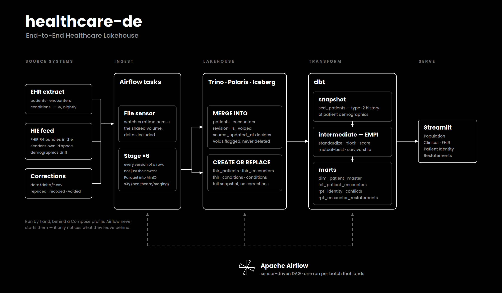
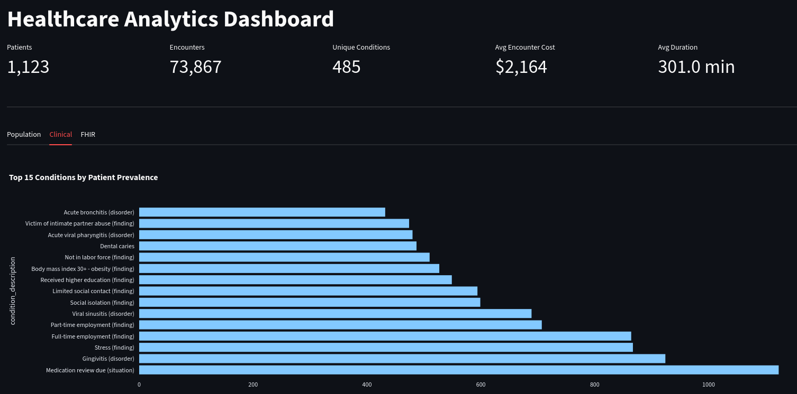

# Healthcare Data Engineering Pipeline

## Overview

A local open-lakehouse pipeline that ingests, transforms, and serves synthetic healthcare data, running entirely in Docker.

It ingests two feeds that describe overlapping populations and **do not share a patient identifier**: a nightly CSV extract from the local EHR, and a FHIR R4 feed treated as coming from an outside health information exchange. Resolving the two onto one person is done by probabilistic matching, and the rows that cannot be resolved are reported rather than dropped. The EHR feed also restates itself — encounters are repriced, re-coded, and voided after they have already loaded — so the Iceberg tables are merged into rather than rebuilt, and patient demographics are versioned as a type-2 dimension.

Those two problems, identity and late arrival, are most of what makes healthcare data engineering different from the general case. See [Scope and limitations](#scope-and-limitations) for what this still does not model.

**Stack:**

| Layer | Technology |
|---|---|
| Data generation | Synthea (CSV + FHIR R4), run independently of the orchestrated pipeline |
| Orchestration | Apache Airflow |
| Object storage | MinIO (S3-compatible) |
| Iceberg catalog | Apache Polaris (REST catalog) |
| Query engine | Trino |
| Transformation | dbt (dbt-trino) |
| Dashboard | Streamlit |

## Scope and limitations

Healthcare data engineering is not one job. It splits into lanes that barely overlap:

- **Provider side** — vendor EHR warehouses (Epic's Clarity and Caboodle, and equivalents), HL7 v2 message feeds through an interface engine, C-CDA documents, and Bulk FHIR `$export`.
- **Payer side** — X12 EDI: 837 claims, 835 remittance, 834 enrollment, 270/271 eligibility. The defining problem there is that claims arrive late and are restated for months after the date of service.
- **Research and analytics** — normalizing either of the above into a common model such as OMOP CDM.

This project sits in the provider-side lane: batch extracts land on shared storage, a sensor picks them up, they are staged to object storage, registered as Iceberg tables, and transformed into marts.

Data from a single synthetic generator is internally consistent by construction: Synthea emits both exports for the same simulated people under the same UUIDs, and emits them once. Two of the problems that dominate real pipelines are therefore absent from the raw data, and this project introduces them deliberately rather than claiming them:

| Problem | How it is introduced | Where it is handled |
|---|---|---|
| No shared patient identifier, and demographics that disagree | `dags/hie_feed.py` rewrites every identifier in the FHIR path into the sending system's own id space and perturbs the demographics — typos, hyphenated surnames, transposed birth dates, missing postal codes, records held twice, records held by only one side | [Patient identity resolution](#patient-identity-resolution-empi) |
| Facts that arrive late and are restated afterwards | `scripts/simulate_amendments.py` emits a timestamped batch of corrections against rows already loaded — repriced claims, re-coded encounters, corrected discharge times, voids, demographic changes | [Late-arriving and restated facts](#late-arriving-and-restated-facts) |

What it still does not model:

| Not modeled | Why it matters |
|---|---|
| HL7 v2 and X12 EDI | The two highest-volume formats in production healthcare integration. Neither appears here. |
| Terminology versioning | Synthea's SNOMED, LOINC, and RxNorm codes are carried as opaque strings. Real code sets are versioned dimensions with valid-from/valid-to (ICD-10 turns over each October, CPT each January). |
| PHI governance | Synthetic data carries no PHI, so there is no de-identification layer, tokenization, row/column security, or access auditing — all mandatory in production under HIPAA, and stricter still under 42 CFR Part 2 for substance-use records. |
| Bitemporality | Rows carry the source system's update time and a revision count, and patient demographics are versioned, but there is no full bitemporal model separating "when was this true" from "when did we learn it" across every table. |
| Matching at scale | Blocking keeps the candidate set small, but the weights are hand-set rather than estimated from measured field reliability on the population, and no reviewer ever works the review queue. |

## Architecture



<sub>Regenerate with `uv run --with cairosvg --with pillow python scripts/render_workflow.py`; `workflow.svg` and `workflow.png` are build outputs of that script.</sub>

### Pipeline stages

**1. Generation**
Synthea generates synthetic patient records in two formats:
- CSV exports: patients, encounters, conditions
- FHIR R4 bundle JSON: one file per patient containing Patient, Encounter, and Condition resources

A second, independent generator (`make simulate-amendments`) writes timestamped correction batches into `data/delta/`. Both generators sit behind a Compose profile so an ordinary `make up` cannot start them: Synthea overwrites the CSV extracts in place, and each amender run emits a new batch of restatements.

Synthea runs as a standalone, one-shot container (`make generate-data`) — it is **not** started or triggered by Airflow. This mirrors how batch source extracts typically arrive: an upstream system drops files onto shared storage on its own schedule, decoupled from the orchestration layer that later picks them up. The Airflow DAG detects new output via a file-mtime sensor rather than depending on the Synthea container directly.

**2. Staging (Airflow + Python)**
Six staging tasks run in parallel. Each reads from the shared data volume and uploads Parquet files to MinIO at `s3://healthcare/staging/<table>/`.

EHR path (CSV). The base extract is staged together with **every** correction batch that has landed, not just the newest version of each row — deciding which version wins is the ingest layer's job, and keeping the superseded versions in staging means a restatement can be audited after the fact instead of vanishing at read time. Each row carries `change_type` and `source_updated_at`; the base extract has no update time of its own, so the file's mtime stands in for it.
- `patients.csv` + `delta/patients_*.csv` → `staging/patients/`
- `encounters.csv` + `delta/encounters_*.csv` → `staging/encounters/`
- `conditions.csv` → `staging/conditions/`

HIE path (FHIR R4). Bundles are read from disk; the production equivalent is NDJSON retrieved from a Bulk FHIR `$export` job. Identifiers are rewritten into the sending system's own id space (`HIEPT-*`, `HIEENC-*`, `HIECND-*`) and the demographics are perturbed, so this path shares no key with the EHR path and disagrees with it about the people both describe. Patients the exchange does not hold are dropped from the feed along with their encounters and conditions, so the feed stays internally consistent.
- Patient resources + US Core race/ethnicity extensions → `staging/fhir_patients/`
- Encounter resources (v3-ActCode class, SNOMED type) → `staging/fhir_encounters/`
- Condition resources (SNOMED code, clinicalStatus, verificationStatus, onset/abatement) → `staging/fhir_conditions/`

Every transformation in `hie_feed.py` is a pure function of the source UUID, so the feed is byte-identical across runs and the match rate is a property of the matching logic rather than of chance.

**3. Ingestion (Trino → Polaris)**
Trino reads from Hive external tables over the MinIO staging Parquet and writes to Polaris-managed Iceberg tables. Polaris registers each table in the `iceberg.default` namespace from the moment of creation.

The two paths load differently, on purpose:

- **`patients` and `encounters` are merged.** The tables are created once with explicit DDL and then `MERGE INTO`-ed. The staged rows are deduplicated to the most recent version per key, and a row only updates when the incoming `source_updated_at` is newer than what the table already holds. Each update bumps a per-row `revision` counter and sets `is_voided` when the correction is a void. Rebuilding with `CREATE OR REPLACE` instead would make every run look like a first load, lose the revision history, and discard Iceberg's snapshot lineage — which is the record of what the table said when a report was run against it.
- **The FHIR path and `conditions` are replaced.** The HIE feed is delivered as a full snapshot each time and has no correction feed, so `CREATE OR REPLACE TABLE ... AS SELECT` is the honest pattern there.

Voids are flagged, never deleted. A reversed claim is part of the audit trail, and removing the row would leave the original figure unexplained.

**4. Transformation (dbt + Trino)**
dbt models run against Trino, reading and writing within the Polaris catalog. `dbt snapshot` runs before `dbt run`, so the type-2 patient dimension records the state the mart is about to be built on.

```
iceberg.default.patients ───┬── stg_patients ────── int_identity_ehr ──┐
                            └── scd_patients  (SCD2 snapshot)          │
                                                                       ▼
iceberg.default.fhir_patients ── stg_fhir_patients ── int_identity_hie ─┴─▶ int_patient_match_candidates
                                                                                      │
                                                                                      ▼
                                                                          int_patient_match_best
                                                                                      │
                                                                                      ▼
iceberg.default.encounters ───── stg_encounters ──┐                        dim_patient_master
iceberg.default.conditions ───── stg_conditions   │                             │        │
iceberg.default.fhir_encounters─ stg_fhir_*       └──▶ fct_patient_encounters ◀─┘        │
                                                       rpt_encounter_restatements        │
                                                       rpt_identity_conflicts ◀──────────┤
                                                       rpt_identity_reconciliation ◀─────┘
```

`fct_patient_encounters` is incremental with a `merge` strategy keyed on `encounter_id`, filtered on `source_updated_at` rather than on ingest time — a claim restated in March and delivered in June carries a March timestamp and must still be picked up by the June build.

**5. Serving**
- Streamlit dashboard queries Trino directly, across five tabs: Population, Clinical, FHIR, Patient Identity, and Restatements
- Trino CLI available for ad-hoc queries across all Polaris-registered tables

## Patient identity resolution (EMPI)

There is no shared key between the EHR extract and the HIE feed, and no national patient identifier to fall back on, so identity has to be inferred from the demographics. The models under `dbt_project/models/intermediate/` do it in the standard stages.

**Standardize.** `int_identity_ehr` and `int_identity_hie` put both feeds into one representation before anything is compared. The EHR records administrative sex as `M`/`F` while FHIR uses the `administrative-gender` value set, Synthea appends a numeric token to every generated name (`Wilderman619`) that one feed strips, and punctuation and case vary independently. None of that is identity, and comparing before normalizing measures the formatting difference rather than the people.

Two traps here are worth naming because both silently corrupt a match rate rather than failing loudly:

- **Codes that look numeric and are not.** A Massachusetts ZIP read as an integer loses its leading zero, so `02494` becomes `2494` and stops matching the same ZIP delivered as text. The staging loader reads every source column as text and the ingest SQL casts explicitly, so the typing is declared rather than inferred. NPIs, account numbers, and SNOMED codes have the same exposure.
- **Sentinels treated as data.** Synthea emits `00000` as a postal code for a patient with no usable address. Left alone, every such patient agrees on postal code with every other and the matcher is handed 15 points of evidence for a pairing that has none. `clean_postal_code` maps the placeholders to null, which scores zero — a sentinel treated as data is worse than a null.

**Block.** `int_patient_match_candidates` proposes candidates from three cheap keys — exact date of birth; phonetically equal surname root plus birth year; phonetically equal given name plus postal code — and scores their union. Comparing all pairs is affordable at a thousand patients and quadratic beyond that, which is what makes naive matching impossible on a real population. Blocking has a cost of its own: a true match that disagrees badly on every blocking key is never proposed, and so is never found.

**Score.** Agreement on each attribute contributes weight roughly in proportion to how much it narrows the population — the intuition behind Fellegi-Sunter weights. Date of birth and surname carry the most. Administrative sex is weak confirmation but strong contradiction, so disagreement scores negative. A field missing on one side scores zero rather than negative: a feed that omits the postal code tells you nothing about whether this is the same person.

| Attribute | Exact | Partial credit |
|---|---|---|
| Date of birth | 30 | 22 transposed month/day · 18 year+month · 14 month+day · 8 year |
| Surname | 25 | 22 hyphen-stripped root · 16 phonetic · 14 edit distance ≤ 2 |
| Given name | 20 | 12 initial-only · 12 phonetic · 11 edit distance ≤ 2 |
| Administrative sex | 10 | 0 if unknown on either side · **−15** if contradictory |
| Postal code | 15 | 0 if missing on either side · **−5** if different |

The weights are hand-set and total 100 at full agreement. A production EMPI estimates them from measured field reliability on its own population and re-estimates as the data drifts.

One operational caveat on the merge interaction: because the ingest only updates a row when the source's own `source_updated_at` advances, fixing a *parsing* bug on our side does not restate already-loaded rows. Correcting how a column is read requires a deliberate backfill — drop and reload the affected table, or re-deliver the extract — not just a redeploy.

**Threshold, and leave the middle alone.** At or above 85 the pair links automatically; between 60 and 85 it goes to a review queue; below 60 it is rejected. The middle band is not a defect — it is where automatic linkage would cause harm. Merging two people who are not the same person puts one patient's diagnoses in another's chart, so the upper threshold is deliberately conservative and the review queue is expected to be non-empty.

**Reduce to one link per person.** Taking each EHR patient's best candidate is not enough: two HIE records can point at the same person, and accepting both attaches one person to two master identities. `int_patient_match_best` requires the choice to be *mutual*, which yields a one-to-one assignment. Records that lose a mutual-best contest are kept and flagged, not dropped — an HIE record whose only strong candidate was already claimed is the signature of a duplicate inside the sending system, and that is a finding worth reporting.

**Survivorship.** `dim_patient_master` holds one row per person the warehouse believes exists, with both source keys when they linked. Where the two feeds disagree, source precedence decides: the EHR is the system of record for everything it populates, and the HIE fills only what the EHR left null. Real MDM uses per-field rules — most recent for address, most complete for name, a designated authority for date of birth — and records which source won for each attribute.

Nothing the rule papers over is thrown away. `rpt_identity_conflicts` is one row per linked pair with the field-level disagreements, and it is the model worth looking at when a downstream count differs from what the source system says: these are the pairs the EMPI is confident describe one person, where the two systems still state different facts about them. `rpt_identity_reconciliation` is the summary — link rate, review queue depth, duplicates, unmatched on each side, and conflicts by field — in long format so a dashboard renders it as one table.

Records awaiting review stay separate identities. The alternative is to pre-empt the reviewer's decision.

## Late-arriving and restated facts

A source extract is not a statement of permanent fact. An encounter is coded, billed, and re-coded a week later when a chart review lands; a claim is repriced when the payer responds; a discharge time is corrected; an encounter is voided outright because it was filed against the wrong patient. On the payer side those corrections keep arriving for months — a service month is not complete until well after it closes.

`make simulate-amendments` writes one timestamped batch of corrections per run into `data/delta/`, against rows the warehouse already holds:

| Correction | Share of batch | What it changes |
|---|---|---|
| Reprice | 50% | `TOTAL_CLAIM_COST` and `PAYER_COVERAGE` against a contracted rate |
| Re-code | 25% | `ENCOUNTERCLASS` — the corrections that move money, and so get audited |
| Correct discharge | 20% | `STOP` shifted by minutes to a day |
| Void | 5% | Row flagged, values preserved |

Patient demographics change too, at a lower rate: address moves, surname changes, and date-of-birth corrections.

Handling them turns on three things:

**The ingest merges rather than rebuilds.** `MERGE INTO` updates a row in place when the incoming `source_updated_at` is newer than what the table holds, increments its `revision`, and sets `is_voided` for a reversal. An append-only load would double-count every repriced claim; a full rebuild would lose the fact that the number ever changed.

**The incremental filter keys on the source's update time, not the ingest time.** That is the whole point of handling late arrival: a claim restated in March and delivered in June carries a March timestamp and must still be picked up by the June build. `fct_patient_encounters` filters on `source_updated_at > max(source_updated_at)` in the existing table.

**A correction for a row that was never loaded is inserted, not dropped.** `WHEN NOT MATCHED THEN INSERT` means a restatement arriving before (or without) its original becomes a new row. For a genuinely late-arriving fact that is the right call — the correction is the only copy you have. It also quietly accepts corrections that reference keys the warehouse does not know, which can mask a referential problem upstream; the `mpi_id` test on `fct_patient_encounters` is set to warn precisely so that orphaned facts surface as a count rather than a silent pass. Quarantining those rows instead belongs to a data-quality layer, which this project does not have.

**Current state and history are separate tables.** The Iceberg `patients` table holds current state — right for "who is this patient now", wrong for every question reaching into the past. `snapshots/scd_patients.sql` versions each row with `dbt_valid_from`/`dbt_valid_to` using the `timestamp` strategy, so a claim can be read against the address that was on file when it was submitted rather than the one on file today. The snapshot runs once per pipeline run and therefore records state at build time: a row corrected twice between two runs contributes one version, not two. That is the usual limitation of snapshotting a mutable source, and the reason the staging layer keeps every delivered version of a row.

`rpt_encounter_restatements` reports how much of the table has been corrected, grouped by revision count and void status, with claim totals alongside. "Total claim cost as first reported" and "as restated" are different numbers, and a pipeline that cannot tell them apart will quietly disagree with finance.

Because the loads are merges, Iceberg's snapshot history is a usable audit trail rather than a list of full rewrites. Any commit can still be read back:

```sql
-- What the table said at a given commit
-- element_at rather than summary['...']: the map subscript throws on an
-- absent key, and not every snapshot summary carries every counter.
SELECT committed_at, snapshot_id, operation,
       element_at(summary, 'total-records') AS total_records
FROM iceberg.default."encounters$snapshots"
ORDER BY committed_at DESC;

SELECT count(*), round(sum(total_claim_cost), 2)
FROM iceberg.default.encounters FOR VERSION AS OF <snapshot_id>;
```

## Getting Started

### Prerequisites

- [Docker](https://docs.docker.com/get-docker/)
- [Docker Compose](https://docs.docker.com/compose/install/)

### 1. Configure environment

```bash
cp env.example .env
```

### 2. Start the stack

```bash
make up
```

Starts MinIO, Polaris, Postgres, Airflow (webserver + scheduler), Trino, and the Streamlit dashboard. Polaris bootstrap runs automatically and creates the `default` catalog backed by `s3://healthcare/iceberg/`.

The two data generators — `synthea` and `amender` — are in the `generators` Compose profile and are **not** started by `make up`. They stand in for upstream systems, and starting one as a side effect of bringing up the stack would overwrite the CSV extracts or emit an unasked-for batch of corrections mid-run.

### 3. Generate synthetic patient data

```bash
make generate-data
```

Runs the Synthea container once and exits — it's independent of the rest of the stack and can be re-run any time to refresh the dataset. Note that it **overwrites** the CSV extracts in place while *adding* to `./data/fhir`, so re-running it against an existing dataset leaves the two exports describing different populations; clear `./data` first if you want a clean regeneration. By default it generates **1,000 living patients** (`docker-compose.yml`'s `synthea` service uses `-p 1000`), plus their associated encounters and conditions, writing to `./data/csv` and `./data/fhir`. A 1,000-patient run typically produces ~1,167 total patient records (some die and are replaced during simulation to reach the target of 1,000 living patients), ~85–90k encounters, and ~45–50k conditions, taking a few minutes and several GB of output.

To change the population size, edit the `command:` line for the `synthea` service in `docker-compose.yml` (the `-p <N>` flag).

### 4. Emit a batch of late-arriving corrections (optional)

```bash
make simulate-amendments
```

Writes one timestamped correction batch per run into `./data/delta/` — repriced claims, re-coded encounters, corrected discharge times, voids, and demographic changes against rows the base extract already contains. Skip it on a first run and the pipeline simply loads the base extract with every row at `revision = 1`; run it between pipeline runs and the next load merges the corrections in and the revision counts climb.

Flags pass through with `ARGS`:

```bash
make simulate-amendments ARGS="--seed 42 --amend-rate 0.05 --patient-rate 0.03"
```

`--seed` makes a batch reproducible. Without it each run is a fresh set of corrections, which is the realistic default.

### 5. Run the pipeline

Trigger via the Airflow UI at [http://localhost:8080](http://localhost:8080) (admin / admin), or:

```bash
make trigger-ingest
```

The DAG first polls (`wait_for_new_synthea_data`, every 5 min for up to 1 hour) for base extracts **or correction batches** newer than the last recorded watermark, so make sure `make generate-data` has completed at least once beforehand. It then runs the following task graph:

```
wait_for_new_synthea_data
  └── [stage_patients, stage_encounters, stage_conditions,
        stage_fhir_patients, stage_fhir_encounters, stage_fhir_conditions]
             └── create_staging_schema
                      └── [create_staging_patients, create_staging_encounters, ...]
                               ├── create_patients_table   ── merge_patients
                               ├── create_encounters_table ── merge_encounters
                               └── [ingest_conditions, ingest_fhir_patients, ...]
                                        └── update_watermark
                                                 └── dbt_snapshot
                                                          └── dbt_run
                                                                   └── dbt_test
```

### 6. Run dbt transformations

The DAG runs `dbt snapshot`, `dbt run`, and `dbt test` automatically, but you can also run them standalone:

```bash
make dbt-run
```

To run tests:

```bash
make dbt-test
```

To capture a new version of the patient dimension, or to rebuild the incremental fact table from scratch after changing its logic:

```bash
docker compose run --rm dbt snapshot
docker compose run --rm dbt run --full-refresh
```

### 7. View the dashboard

```bash
make streamlit
```

Opens at [http://localhost:8501](http://localhost:8501). Five tabs:

| Tab | Shows |
|---|---|
| Population | Demographics, encounter volume by month |
| Clinical | Top conditions by prevalence, encounter class mix, cost by class and age |
| FHIR | Condition clinical status, EHR-vs-HIE encounter counts for linked patients |
| Patient Identity | Link rate, linkage outcome per identity, match-score distribution against both thresholds, conflicts by field, and a sample of the linked pairs that disagree most |
| Restatements | Encounters by revision count, claim cost by revision, patient version history from the SCD2 snapshot, and the Iceberg snapshot lineage |



### 8. Query with Trino

```bash
make trino-cli
```

Example queries:

```sql
-- All Polaris-registered tables
SHOW TABLES IN iceberg.default;

-- Identity resolution summary
SELECT * FROM iceberg.default.rpt_identity_reconciliation ORDER BY category, metric;

-- Compare EHR vs HIE encounter counts for the same person. The two feeds share
-- no patient key, so this goes through the master index rather than a join.
SELECT
    m.mpi_id,
    m.match_score,
    COUNT(DISTINCT e.encounter_id)  AS ehr_encounters,
    COUNT(DISTINCT f.encounter_id)  AS hie_encounters
FROM iceberg.default.dim_patient_master m
LEFT JOIN iceberg.default.encounters      e ON e.patient_id = m.ehr_patient_id
LEFT JOIN iceberg.default.fhir_encounters f ON f.patient_id = m.hie_patient_id
WHERE m.record_source = 'both'
GROUP BY 1, 2
ORDER BY 3 DESC
LIMIT 20;

-- Linked pairs the two systems disagree about most
SELECT mpi_id, match_score, conflict_count,
       ehr_last_name, hie_last_name, ehr_birth_date, hie_birth_date
FROM iceberg.default.rpt_identity_conflicts
WHERE conflict_count > 0
ORDER BY conflict_count DESC, match_score ASC
LIMIT 20;

-- Who is sitting in the review queue, and why
SELECT mpi_id, pending_review_hie_id, pending_review_score, full_name, birth_date
FROM iceberg.default.dim_patient_master
WHERE record_source = 'ehr_only_pending_review'
ORDER BY pending_review_score DESC;

-- How much of the encounter table has been restated
SELECT * FROM iceberg.default.rpt_encounter_restatements;

-- A single encounter's current state, including how often it has changed
SELECT encounter_id, encounter_class, total_claim_cost, is_voided,
       revision, source_updated_at, ingested_at
FROM iceberg.default.encounters
WHERE revision > 1
ORDER BY revision DESC
LIMIT 10;

-- Patient demographics as of a point in the past (SCD2)
SELECT patient_id, full_name, city, postal_code, dbt_valid_from, dbt_valid_to
FROM iceberg.default.scd_patients
WHERE dbt_valid_to IS NOT NULL
ORDER BY dbt_valid_from DESC
LIMIT 20;

-- Iceberg commit history: every MERGE is a snapshot you can still read back
SELECT committed_at, snapshot_id, operation,
       element_at(summary, 'total-records') AS total_records
FROM iceberg.default."encounters$snapshots"
ORDER BY committed_at DESC;

-- Active conditions by clinical status (FHIR)
SELECT clinical_status, COUNT(*) AS condition_count
FROM iceberg.default.fhir_conditions
GROUP BY 1
ORDER BY 2 DESC;
```

## Project Structure

```
.
├── dags/
│   ├── healthcare_pipeline.py   # Airflow DAG (staging + Trino MERGE ingest)
│   └── hie_feed.py              # Rewrites the FHIR path into an outside HIE feed
├── scripts/
│   └── simulate_amendments.py   # Late-arriving correction batches -> data/delta/
├── dbt_project/
│   ├── macros/
│   │   └── standardize.sql      # normalize_gender, normalize_name, name_root, safe_soundex
│   ├── models/
│   │   ├── staging/             # stg_patients, stg_encounters, stg_conditions,
│   │   │                        # stg_fhir_patients, stg_fhir_encounters, stg_fhir_conditions
│   │   ├── intermediate/        # int_identity_ehr, int_identity_hie,
│   │   │                        # int_patient_match_candidates, int_patient_match_best
│   │   └── marts/               # dim_patient_master, fct_patient_encounters,
│   │                            # rpt_identity_conflicts, rpt_identity_reconciliation,
│   │                            # rpt_encounter_restatements
│   ├── snapshots/
│   │   └── scd_patients.sql     # Type-2 history over patient demographics
│   └── profiles.yml             # dbt-trino connection
├── trino/
│   └── catalog/
│       ├── iceberg.properties   # Polaris REST catalog
│       └── file.properties      # Hive connector for MinIO staging
├── dashboard/
│   └── app.py                   # Streamlit (trino.dbapi)
├── polaris-bootstrap.sh         # Creates Polaris catalog on startup
├── docker-compose.yml
├── Dockerfile.airflow
├── Dockerfile.dbt
└── Dockerfile.synthea
```

### Upgrading an existing deployment

`patients` and `encounters` gained columns (`is_voided`, `source_updated_at`, `revision`, `ingested_at`, plus address fields on patients) and are now created by explicit DDL guarded with `IF NOT EXISTS`. A pre-existing table from an earlier version of this project has the old schema, and the guard will skip creation rather than fix it, so the `MERGE` will fail. Drop the affected tables once and let the DAG recreate them:

```sql
DROP TABLE IF EXISTS iceberg.default.patients;
DROP TABLE IF EXISTS iceberg.default.encounters;
DROP TABLE IF EXISTS file.staging.patients;
DROP TABLE IF EXISTS file.staging.encounters;
```

The dbt image bakes `dbt_project/` at build time, so rebuild it after changing a model: `docker compose build dbt`.

## Accessing Services

| Service | URL | Credentials |
|---|---|---|
| Airflow UI | http://localhost:8080 | admin / admin |
| MinIO Console | http://localhost:9001 | admin / password123 |
| Polaris API | http://localhost:8181 | — |
| Trino UI | http://localhost:8082 | — |
| Streamlit | http://localhost:8501 | — |

## Polaris persistence

Being an Iceberg REST catalog and persisting its own bookkeeping are two different concerns. Polaris's REST API is how Trino looks up "where's the current metadata pointer for table X" — but Polaris itself still needs to store *its own* catalog/namespace/grant registrations somewhere, separate from the actual Iceberg data+metadata files (which always lived safely in MinIO). By default Polaris keeps that bookkeeping in memory, so a container restart would silently forget every catalog, namespace, and grant even though the underlying data was untouched.

This stack instead points Polaris at the existing Postgres container via its `relational-jdbc` persistence backend (`polaris-bootstrap-db` runs `apache/polaris-admin-tool bootstrap` against a dedicated `polaris` database before Polaris starts — see `docker-compose.yml` and `postgres/init-polaris-db.sh`), so catalogs/namespaces/grants survive `make down && make up`. `polaris-bootstrap.sh` and `polaris-admin-bootstrap.sh` are both idempotent, so they're safe to rerun on every startup.

If you only restart the `polaris` container on its own (not the full stack), also restart `trino` (`docker compose restart trino`) — Trino caches its OAuth session with Polaris and needs a fresh one.
